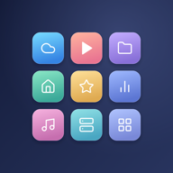

<p align="center"></p>

# Unraid Launcher

**Your favourite Unraid apps, one tap away.**

A lightweight, self-hosted home screen for your Unraid services. Discover Docker containers, pin your everyday apps, organise the rest into folders, and open them using your server’s Tailscale hostname. Your dashboard is saved on the server and shared across devices.

[](https://github.com/wranglatang/UNRAID-Launcher/actions/workflows/checks.yml)
[](https://github.com/wranglatang/UNRAID-Launcher/actions/workflows/codeql.yml)
[](https://github.com/wranglatang/UNRAID-Launcher/actions/workflows/security.yml)
[](LICENSE)

## What you can do

- **Pin favourites** for quick access from the home screen.
- **Create folders** for media, automation, infrastructure, or any groups you like.
- **Discover containers automatically** through the Unraid GraphQL API, including available icons and web interface links.
- **Customise names and links** when an app needs a different URL, port, or protocol.
- **Search your chosen apps** across favourites and folders.
- **Use the same dashboard everywhere**, with a layout saved on your server.
- **Add it to your phone’s Home Screen**, with an app icon and automatic light/dark appearance.

The launcher reads container information. It does not start, stop, or change your containers, and does not need the Docker socket.

> **Private network use:** there is no login screen. Anyone who can reach the launcher can view and edit the shared dashboard. Keep it on a trusted network or behind access controls. Publishing a Docker port does not restrict access to Tailscale automatically.

## Getting started

### What you need

- An Unraid server with Docker and the Unraid GraphQL API available.
- An Unraid API key with permission to read Docker container information.
- Tailscale and MagicDNS already configured on your server and devices, if you want Tailscale links.
- Docker; Docker Compose is optional.

The launcher does not install Tailscale or proxy your applications. Your browser must be able to reach each service directly. No minimum Unraid version has been verified yet; compatibility depends on the available API schema.

**Distribution status:** installation currently builds the image from source. A published container image and Community Applications listing are planned; an Apps-tab installation is not available yet.

### 1. Get the source

On your Unraid server:

```sh
mkdir -p /mnt/user/appdata/unraid-launcher
git clone https://github.com/wranglatang/UNRAID-Launcher.git /mnt/user/appdata/unraid-launcher/source
cd /mnt/user/appdata/unraid-launcher/source
```

If Git is unavailable, download **Code → Download ZIP** from [the repository](https://github.com/wranglatang/UNRAID-Launcher), extract it, and copy the files into that source directory.

### 2. Create an API key

In Unraid, open **Settings → Management Access → API Keys** and create a key for the launcher. Give it only the permissions needed to read Docker container information. See [Unraid’s API instructions](https://docs.unraid.net/API/how-to-use-the-api/) for API key management.

Keep the key private. The backend passes it to Unraid; it is not sent to your browser or forwarded to icon hosts. The interactive GraphQL sandbox does not need to be enabled.

### 3. Configure your server

From the source directory:

```sh
cp .env.example .env
chmod 600 .env
```

Edit `.env` with your own values:

```dotenv
UNRAID_URL=http://tower
UNRAID_API_KEY=replace-with-your-read-only-api-key
TAILSCALE_HOSTNAME=tower.your-tailnet.ts.net
LAUNCHER_PORT=9999
DEMO_MODE=false
```

- `UNRAID_URL` is your Unraid WebGUI address, reachable **from the container**. The launcher appends `/graphql`. Use your actual IP address or resolvable hostname, including a port if needed. `localhost` would refer to the launcher container itself.
- `TAILSCALE_HOSTNAME` is the destination hostname for app links: no scheme, path, or port. Use your actual MagicDNS hostname. Leave it empty to manage the hostname in the app instead.
- Change `LAUNCHER_PORT` if port `9999` is already occupied.
- Keep `DEMO_MODE=false` on your real server.

Your `.env` and saved dashboard data are excluded from Git. Never attach them to an issue or include them in a screenshot.

### 4. Start the launcher

**With Docker Compose:**

```sh
docker compose up -d --build
```

**Without Docker Compose:**

```sh
docker build -t unraid-launcher:local .
docker run -d --name unraid-launcher --restart unless-stopped \
  --env-file .env -e DATA_DIR=/data -p 9999:3000 \
  -v unraid-launcher-data:/data \
  --security-opt=no-new-privileges:true --cap-drop=ALL \
  unraid-launcher:local
```

The direct Docker command uses `9999` literally; edit `-p` to choose another host port. `LAUNCHER_PORT` is used by Compose only. To install through Unraid’s Docker screen using an appdata folder, follow the [native Unraid guide](deploy/README.md).

### 5. Open your dashboard

Open `http://tower.your-tailnet.ts.net:9999`, substituting your real hostname and port. You can also use the server’s reachable LAN address.

Open the settings cog to check the connection. Discovered containers appear in the **App tray** when you choose **Edit dashboard**. A new dashboard starts empty so you can choose exactly what appears.

## Make it yours

### Add favourite apps

1. Open the floating **settings cog**.
2. Choose **Edit dashboard**.
3. Find an app in the **App tray** and tap its **star**.
4. The app moves into **Favourites**, displayed above your folders.
5. Use its **up/down arrows** to choose the order.
6. Choose **Save changes** to save the dashboard for all your devices.

Tap a favourite to open it. To remove a favourite, return to edit mode and tap its filled star; it returns to the app tray. This does not uninstall or stop the container.

### Organise apps into folders

1. Enter **Edit dashboard** and choose **New folder**.
2. Replace **New folder** with a name such as `Media` or `Home automation`.
3. In the app tray, use an app’s **Add to folder** menu to choose the folder.
4. Use the up/down arrows to arrange apps within the folder and arrange the folders themselves.
5. Choose **Save changes**.

An app appears in one location at a time: favourites, one folder, or the app tray. Use its move menu to change location. Apps left in the tray stay off the home screen. Deleting a folder returns its apps to the tray.

### Rename an app or fix its link

1. In edit mode, choose the app’s **pencil** button.
2. Change its **Display name**, if wanted.
3. Set a **Custom URL** for a specific address, or set a **Web port** and **Port protocol**.
4. Choose **Apply**, then **Save changes** on the dashboard.

A custom URL takes priority over automatic discovery. Leave overrides empty to use the discovered link. An amber marker on a pencil button means there is a configuration warning; open it to see the details.

The tray also contains an **Unraid** shortcut. Star it or add it to a folder like an app. It opens your Unraid WebGUI and has no Docker status.

### Settings and saving

Settings lets you choose the destination hostname, the default protocol for generated links, and the refresh interval. Choose **Save settings** to apply those preferences.

When `TAILSCALE_HOSTNAME` is set in the container environment, the hostname is read-only in Settings. Change the environment value and recreate the container to apply it. Other preferences stay editable.

Dashboard edits remain drafts until you choose **Save changes**; **Cancel** discards them. If another device saves first, cancel and reload the latest layout before trying again. Container names identify apps, so renaming a Docker container makes it appear as a new app.

### Add to your phone’s Home Screen

On iPhone or iPad, open the launcher in Safari and choose **Share → Add to Home Screen**. Keep **Open as Web App** enabled if offered. Other browsers may offer their own shortcut option.

Links open a new browser context. iOS may show services in a Safari-controlled view; the launcher does not manage that view’s navigation history. If an old shortcut shows an outdated icon, remove it and add it again. Your saved dashboard stays on the server.

## Configuration reference

| Variable | Purpose | Default |
| --- | --- | --- |
| `UNRAID_URL` | Unraid WebGUI origin, reachable from the container | `http://tower` |
| `UNRAID_API_KEY` | Private key with Docker read permission | Empty |
| `TAILSCALE_HOSTNAME` | Destination hostname; locks the hostname setting when supplied | Empty |
| `LAUNCHER_PORT` | Compose host port | `9999` |
| `DATA_DIR` | Directory containing `dashboard.json` | `/data` in Docker; `./data` locally |
| `PORT` | Internal web server port | `3000` |
| `DEMO_MODE` | Explicit sample-data preview | `false` |

Compose uses internal port `3000`; change the host port with `LAUNCHER_PORT`. Changing `.env` requires container recreation: run `docker compose up -d` again. A plain restart does not reload environment values.

## How discovery works

The backend reads Unraid’s container metadata and tries supported GraphQL schema variants. It resolves WebUI template placeholders, maps internal ports to published host ports, and uses your configured hostname for generated links. Discovered links preserve their HTTP/HTTPS scheme unless overridden.

A single published TCP port can be used as a fallback. Multiple ports, host networking, or containers sharing another container’s VPN/network may need an explicit URL or port. A published port alone does not prove an HTTP service is available.

Container status reflects Docker’s reported state, not an HTTP check of the destination. If discovery temporarily fails, the launcher can show its last results as stale. Missing icons fall back to a local symbol. Older API schemas may not expose template icons or all discovery metadata.

## Updates and backups

For a Git checkout using Compose:

```sh
git pull --ff-only
docker compose build --pull
docker compose up -d
```

For a downloaded ZIP, replace the source with the new download while preserving `.env`, then rebuild. For direct Docker and Docker-screen installs, see [native updates](deploy/README.md#updating).

Compose uses its `launcher-data` named volume. The direct Docker command uses `unraid-launcher-data`. The Docker-screen guide uses a bind-mounted appdata folder. Keep the same data mapping when updating or switching install methods.

Back up `dashboard.json` from your data volume/folder and back up `.env` securely. Stop the container while restoring data. Recreating a container preserves mounted data; **`docker compose down -v` deletes Compose volumes**. A bind-mounted folder must be writable by the container’s `node` user, UID/GID `1000:1000`.

## Troubleshooting

| Symptom | What to check |
| --- | --- |
| API key needed | Set `UNRAID_API_KEY`, then recreate the container. |
| Unraid cannot be reached | Check `UNRAID_URL`, container networking, name resolution, and HTTPS certificate trust. |
| API key rejected | Check Docker read permissions and whether the key was revoked. |
| Connected but home screen is empty | Open **Edit dashboard** and star apps or put them in folders. |
| An app opens the wrong address | Check the hostname; set a URL or published host port using its pencil button. |
| Hostname is read-only | It is managed by `TAILSCALE_HOSTNAME` in the environment. |
| Dashboard will not save | Check data-folder permissions and free space; reload if another device saved first. |
| App icon is missing | The API may not expose one, or its source may be unavailable. A fallback is expected. |
| Healthy container, disconnected Unraid | `/api/health` checks the launcher, not the upstream Unraid connection. |

For Compose logs, run `docker compose logs --tail=100 unraid-launcher`. For direct Docker, use `docker logs --tail=100 unraid-launcher`. Remove credentials and personal information before sharing logs.

## Local development and demo

Use Node.js **24 LTS** to match the container; the project declares Node.js 22 or newer.

```sh
npm ci
cp .env.example .env
npm run dev
```

Open the local URL printed by Vite. To explore without Unraid, set `DEMO_MODE=true` and leave the API key empty. Demo mode shows sample containers and saves a sample layout in your local data directory. Demo links are illustrative. Keep demo mode disabled on your real server.

```sh
npm test
npm run build
npm start
```

The production server serves the frontend and API together on port `3000`. See [CONTRIBUTING.md](CONTRIBUTING.md) and [SECURITY.md](SECURITY.md) for contributions and private security reporting.

## Automated checks and maintenance

GitHub Actions is configured for tests, production builds, XML validation, a Docker startup/persistence check, CodeQL analysis, and Trivy secret/container scans. Security checks also have a weekly schedule. Dependabot proposes weekly npm, Docker base-image, and workflow-action updates. These checks do not publish images or automatically merge changes.

Enable GitHub secret scanning, push protection, private vulnerability reporting, and branch protections in repository settings; see the [maintainer checklist](docs/MAINTAINING.md). Scans supplement review and cannot guarantee an absence of vulnerabilities.

GitHub may disable scheduled workflows after 60 days of repository inactivity. Check alerts, failed runs, dependency updates, and schedule status regularly, even when no new features are planned.

## Support and credits

For bugs or suggestions, [open an issue](https://github.com/wranglatang/UNRAID-Launcher/issues). Include installation method, relevant versions, and reproduction steps. Report vulnerabilities privately using [SECURITY.md](SECURITY.md).

Built with React, Express, Vite, and Lucide icons. Demo logos come from [Homarr Dashboard Icons](https://github.com/homarr-labs/dashboard-icons); these assets and service trademarks retain their respective licences and owners. Real-container icons come from your Unraid metadata.

Unraid Launcher is an independent community project, not affiliated with or endorsed by Unraid/Lime Technology or Tailscale.

## Licence

[MIT](LICENSE) © 2026 Philip Wrangles. Third-party packages and assets retain their own licences.
